# Week 8: Containers at Scale with ECS on Fargate

**Goal:** take the Week 3 app (Next.js frontend + Parse Server backend), which Weeks 5–7 ran as `docker compose` on **one EC2 instance**, and run it as a **load-balanced, self-healing, auto-scaling service on ECS Fargate across two Availability Zones**, deployed by the existing GitHub Actions pipeline using **blue/green deployments** with automatic and manual rollback.

Everything is built with Terraform (remote state in S3 + DynamoDB locking) and deployed through GitHub Actions with OIDC. No SSH, no servers to manage.

---

## Table of contents

1. [The problem Week 8 solves](#1-the-problem-week-8-solves)
2. [Architecture](#2-architecture)
3. [Repositories and layout](#3-repositories-and-layout)
4. [Hands-on build-up (Steps 1–2)](#4-hands-on-build-up-steps-12)
5. [Prerequisites](#5-prerequisites)
6. [Infrastructure with Terraform](#6-infrastructure-with-terraform)
7. [Why ECS built-in blue/green instead of CodeDeploy](#7-why-ecs-built-in-bluegreen-instead-of-codedeploy)
8. [Verifying the running stack](#8-verifying-the-running-stack)
9. [Self-healing with zero downtime](#9-self-healing-with-zero-downtime)
10. [Locking MongoDB Atlas to the NAT IP](#10-locking-mongodb-atlas-to-the-nat-ip)
11. [Updating the CI/CD pipeline](#11-updating-the-cicd-pipeline)
12. [First blue/green deployment through the pipeline](#12-first-bluegreen-deployment-through-the-pipeline)
13. [Rollback demos](#13-rollback-demos)
14. [Autoscaling demo](#14-autoscaling-demo)
15. [Issues faced (summary)](#15-issues-faced-summary)
16. [Deliverables checklist](#16-deliverables-checklist)
17. [Open items and next steps](#17-open-items-and-next-steps)
18. [Cleanup](#18-cleanup)

---

## 1. The problem Week 8 solves

Weeks 5–7 ended with this:

```
Internet → EC2 instance (public IP) → docker compose → frontend, backend, dashboard, mongo
```

It works, but it has four problems. Every Week 8 component exists to fix one of them:

| # | Problem with one EC2 box | Week 8 fix |
|---|---|---|
| 1 | **One machine.** If it dies, the site is down | ALB + multiple Fargate tasks across **2 AZs** |
| 2 | **Nobody is watching.** A dead container stays dead until someone notices | ECS **service** + ALB health checks replace failed tasks automatically |
| 3 | **Fixed capacity.** Traffic spikes hit the same box | **Target-tracking autoscaling** on CPU (2–4 tasks) |
| 4 | **Deploys cause downtime.** SSH → `pull` → restart | **Blue/green** deployments with instant rollback |

---

## 2. Architecture

```
GitHub push (Week 3 app repo, master)
  → lint-test → build-and-push (ECR :<sha>) → deploy [matrix: frontend, backend] → notify (Discord)
                                                 │
                         register new task definition revision → update ECS service
                                                 │  (strategy = BLUE_GREEN)
                                                 ▼
Browser ──► ALB (public subnets, eu-north-1a + 1b)
             ├─ :80   → listener rule → frontend-blue / frontend-green (weights 100/0 ↔ 0/100)
             └─ :1337 → listener rule → backend-blue  / backend-green
                                                 │
                         Fargate tasks in PRIVATE subnets (no public IPs), 2–4 per service
                                                 │  outbound only, via NAT Gateway (one fixed IP)
                                                 ▼
                                          MongoDB Atlas (allow-listed to the NAT IP only)
```

| Layer | Resources |
|---|---|
| Network | VPC `10.20.0.0/16`, 2 public + 2 private subnets in 2 AZs, Internet Gateway, NAT Gateway |
| Security | `alb-sg` (open on 80/1337) → `tasks-sg` (only accepts traffic **from `alb-sg`**) |
| Secrets | SSM Parameter Store `SecureString`: `DATABASE_URI`, `PARSE_MASTER_KEY` |
| Compute | ECS cluster, 2 Fargate services (frontend `:3000`, backend `:1337`), 0.5 vCPU / 1 GB per task |
| Traffic | ALB, 2 listeners, 2 listener rules, 4 target groups (blue + green per service) |
| Deployments | ECS built-in **blue/green**, 5-minute bake time, circuit breaker with rollback |
| Scaling | Application Auto Scaling, target tracking on `ECSServiceAverageCPUUtilization` = 60% |
| CI/CD identity | New OIDC role `ebotprog-w8-github-actions` |
| State | S3 `ebotprog-terraform-state` (key `week8/terraform.tfstate`) + DynamoDB `terraform-locks` |

---

## 3. Repositories and layout

Week 8 follows the same **two-repo pattern** as Week 7: the pipeline runs in the **Week 3 app repo** (where the code and submodules live), and the weekly repo holds the infrastructure and documentation.

```
Learning-Devops-Week-8-ECS-Fargate/        ← this repo (infra + docs)
├── infra/
│   ├── backend.tf          S3 + DynamoDB remote state (key week8/terraform.tfstate)
│   ├── providers.tf        AWS provider ~> 6.4 (needed for ECS blue/green)
│   ├── variables.tf  locals.tf  outputs.tf
│   ├── network.tf          VPC, subnets, IGW, NAT, routes
│   ├── security.tf         alb-sg → tasks-sg
│   ├── secrets.tf          SSM parameters
│   ├── iam.tf              execution role, ECS load-balancer infrastructure role
│   ├── github-oidc.tf      pipeline role (trusts the Week 3 app repo)
│   ├── alb.tf              ALB, listeners, weighted listener rules, blue/green target groups
│   ├── ecs.tf              cluster, log groups, task definitions, services
│   ├── autoscaling.tf      target tracking on CPU
│   ├── dns.tf              optional Route 53 record (not used)
│   ├── scripts/deploy.sh   manual blue/green deploy for demos
│   └── terraform.tfvars.example
├── screenshots/
└── README.md

Learning-Devops-Week-3-Docker-Deep-Dive/   ← app repo (pipeline runs here)
├── .github/workflows/deploy.yml           ← deploy job replaced (§11)
├── CRUD-nextjs-frontend/                  ← submodule, branch crud-multistage-final
├── CRUD-parse-server-backend/             ← submodule, branch crud-multistage-final
└── docker-compose.yml                     ← unchanged, local dev only
```

**How each compose service was translated:**

| docker-compose (Weeks 3–7) | Week 8 | Why |
|---|---|---|
| `frontend` | ECS service `ebotprog-w8-frontend`, ALB `:80` | Same image |
| `backend` | ECS service `ebotprog-w8-backend`, ALB `:1337` | Same image. The browser calls Parse directly, so it needs its own listener |
| `database` (mongo) | **MongoDB Atlas (free M0)** | Tasks are disposable and scale out. A DB inside them would lose data and get duplicated |
| `backend-dashboard` | Dropped | Not required this week (see §17) |
| `depends_on` | Gone | Atlas is always on, and the ALB only routes to tasks passing health checks |
| `ports: "1338:1337"` | ALB listener → container port | No host ports on Fargate: every task has its own IP (`awsvpc`) |
| `healthcheck:` | ALB target group health checks (`/` and `/parse/health`) | Same paths as compose |
| `restart: unless-stopped` | The ECS service | Replaces any task that stops |
| `.env` | `terraform.tfvars` (gitignored) + SSM | Secrets never live in the repo or on a server |

---

## 4. Hands-on build-up (Steps 1–2)

Before the full build, I worked through two smaller steps to learn each piece in isolation.

**Step 1: one Fargate task, no load balancer.** Default VPC, public subnet, `assign_public_ip = true`, reached directly at `http://<task-ip>`. First with public `nginx`, then with the Week 3 **backend image** pointed at Atlas.

- Stopping the task with `aws ecs stop-task` showed the **service starting a replacement**, with a new task ID and a **new public IP**. That is exactly why Step 2 needs an ALB.
- Task definitions are versioned: changing the image or env vars created revision 2, 3, 4… instead of editing in place.

**Step 2: ALB + 2 tasks across 2 AZs.** My own VPC with private subnets and NAT, an ALB with one stable DNS name, tasks reachable only from the ALB's security group, a rolling deployment, and the circuit breaker.

Issues from these steps:

> **Issue: `terraform plan` → `lookup sts.eu-north-1.amazonaws.com: no such host`.** This was a local DNS/connectivity problem on my machine, not Terraform. Fixed by restoring the connection (flush DNS / switch DNS server) and confirming with `aws sts get-caller-identity`.

> **Issue: `aws logs tail /ecs/ebotprog-w8` → `InvalidParameterException … logGroupName`.** Git Bash on Windows rewrites arguments starting with `/` into Windows paths. Fixed permanently with `export MSYS_NO_PATHCONV=1` in `~/.bashrc`. The same fix applies to SSM parameter names.

> **Issue: Atlas showed no free M0 option.** Atlas allows **one free cluster per project**, and my project already had `Cluster0` (FREE). I reused it instead of creating a paid M10/M30.

> **Issue: backend crash loop (`Essential container in task exited`, exit code 1).** CloudWatch logs showed `querySrv ENOTFOUND _mongodb._tcp.cluster0.abcde.mongodb.net`: I had pasted the **example** connection string with a placeholder hostname. Fixed with the real string from Atlas → Connect → Drivers.
> **Lesson:** on Fargate there's no SSH. The **stopped reason + exit code** tells you *that* it failed; **CloudWatch Logs** tell you *why*.

---

## 5. Prerequisites

**Images in ECR.** Terraform's first task definition revision uses `:latest`, so I checked both repos had it:

```bash
for r in crud-nextjs-frontend crud-parse-server-backend; do
  aws ecr describe-images --region eu-north-1 --repository-name "$r" \
    --image-ids imageTag=latest --query 'imageDetails[0].[imageTags, imagePushedAt]' --output text
done
```

> **Issue: `In function contains(), invalid type for value: None`.** My first query filtered with `contains(imageTags, 'latest')`, which crashes on **untagged** images (older builds whose tag moved). Asking for `--image-ids imageTag=latest` directly avoids the filter.

**Remote state.** Reused the Week 5 S3 bucket and DynamoDB lock table, with a separate key:

```hcl
terraform {
  backend "s3" {
    bucket         = "ebotprog-terraform-state"
    key            = "week8/terraform.tfstate"
    region         = "eu-north-1"
    encrypt        = true
    dynamodb_table = "terraform-locks"
  }
}
```

Checked first with `aws s3api head-bucket`, `aws dynamodb describe-table` (status `ACTIVE`) and `aws s3 ls s3://ebotprog-terraform-state/` (`week5/`, `week6/` present). The state matters more than ever this week: it contains the SSM secret values, so it belongs encrypted in S3, never in git or on a laptop. Both cost effectively $0 while idle.

> **Lesson:** my first Week 8 package only had local state. Remote state with locking should be the default for every project, including this one.

**MongoDB Atlas.** `Cluster0` (M0, free), user `parse` with read/write. Network Access was `0.0.0.0/0` during setup and was locked down later (§10).

**Week 5/6 EC2 stack destroyed.** Week 8 doesn't use it, and it costs money.

---

## 6. Infrastructure with Terraform

`terraform.tfvars` (gitignored) holds the Atlas URI, the Parse master key (`openssl rand -hex 32`), the app ID, and the repo the pipeline role trusts:

```hcl
github_owner    = "EbotProg"
github_repo     = "Learning-Devops-Week-3-Docker-Deep-Dive"   # where the pipeline runs
github_owner_id = "*"                                          # same wildcard trust as Week 7
github_repo_id  = "*"
```

Key parts of the code.

**Blue/green on the service** (`ecs.tf`):

```hcl
deployment_controller { type = "ECS" }

deployment_configuration {
  strategy             = "BLUE_GREEN"
  bake_time_in_minutes = 5          # blue stays alive 5 min after the switch
}

deployment_circuit_breaker {
  enable   = true
  rollback = true                   # green never healthy → roll back automatically
}

load_balancer {
  target_group_arn = aws_lb_target_group.blue[each.key].arn
  container_name   = each.key
  container_port   = each.value.container_port

  advanced_configuration {
    alternate_target_group_arn = aws_lb_target_group.green[each.key].arn
    production_listener_rule   = aws_lb_listener_rule.prod[each.key].arn
    role_arn                   = aws_iam_role.ecs_lb_infra.arn
  }
}

lifecycle {
  ignore_changes = [task_definition, load_balancer, desired_count]
}
```

**The weighted listener rule ECS flips during a deployment** (`alb.tf`):

```hcl
action {
  type = "forward"
  forward {
    target_group { arn = aws_lb_target_group.blue[each.key].arn,  weight = 100 }
    target_group { arn = aws_lb_target_group.green[each.key].arn, weight = 0 }
  }
}
lifecycle { ignore_changes = [action] }
```

**Why the `ignore_changes`:** the pipeline changes the task definition, ECS changes the rule weights and which target group is primary, and autoscaling changes the task count. Without these lines, every `terraform apply` would undo the last deployment or scaling action. Terraform owns the *infrastructure*; the pipeline owns *what's running*.

```bash
cd infra
terraform init -upgrade
terraform plan
terraform apply
```

**Plan: 46 resources to add**

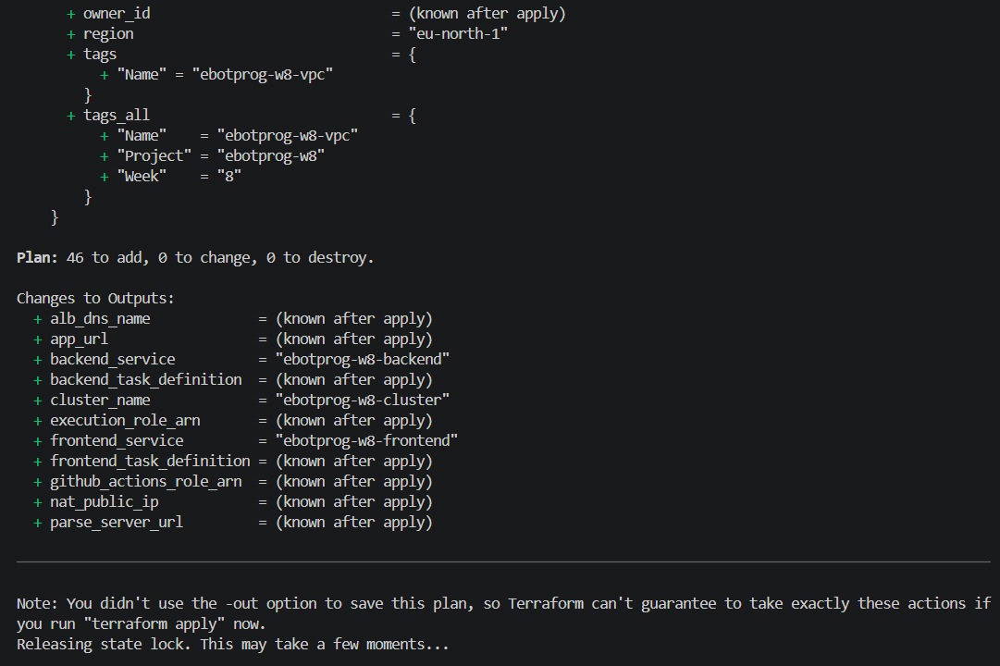

**Apply complete, with outputs** (ALB URL, Parse URL, NAT IP, role ARNs):

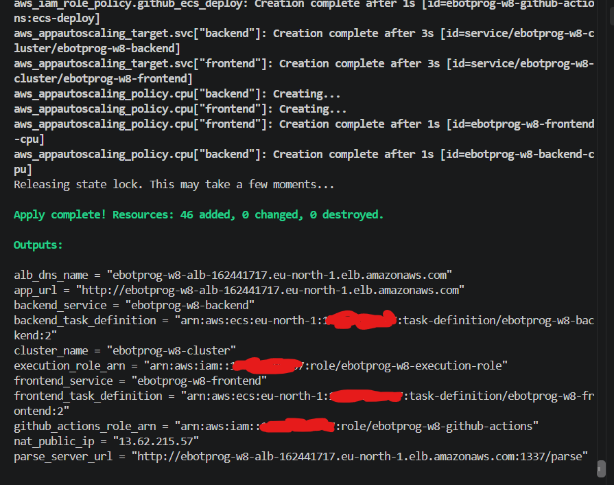

---

## 7. Why ECS built-in blue/green instead of CodeDeploy

The original design used **AWS CodeDeploy** for blue/green (CodeDeploy app, deployment groups, appspec). The first `terraform apply` failed:

```
Error: creating CodeDeploy Application (ebotprog-w8-app): operation error CodeDeploy:
CreateApplication, https response error StatusCode: 400, api error SubscriptionRequiredException:
The AWS Access Key Id needs a subscription for the service
```

**Diagnosis:**
- `aws deploy list-applications --region eu-north-1` returned the same `SubscriptionRequiredException`, so the account itself could not use CodeDeploy at all. It wasn't Terraform or IAM.
- The account panel showed **Free plan status** ($130.79 credits, 91 days remaining). AWS lists CodeDeploy as supported on the Free plan, but in practice it was blocked for this account.

**Options considered:**

| Option | Trade-off |
|---|---|
| Upgrade to a paid plan | Probably unblocks CodeDeploy, but the account no longer stops automatically when credits run out, and the fix still isn't guaranteed |
| AWS Support case | Free, but could take longer than the submission deadline |
| **ECS built-in blue/green** (available since July 2025) | No extra service. Same blue/green target groups, traffic switch and instant rollback |

**Decision:** switch to ECS built-in blue/green and keep the account on the Free plan.

| | CodeDeploy blue/green | ECS built-in blue/green (used) |
|---|---|---|
| Extra service | CodeDeploy app + deployment groups + appspec | None. It's a setting on the ECS service |
| Traffic switch | Changes the listener's target group | Changes the listener **rule weights** (100/0 → 0/100) |
| Old version kept alive | `termination_wait_time_in_minutes` | `bake_time_in_minutes` |
| Automatic rollback | On deployment failure / alarms | Circuit breaker / alarms |
| Manual rollback | "Stop and roll back" in CodeDeploy | `aws ecs stop-service-deployment --stop-type ROLLBACK` |
| Pipeline | Register task def + appspec + CodeDeploy | Register task def + update service |
| IAM | CodeDeploy service role | ECS infrastructure role (`AmazonECSInfrastructureRolePolicyForLoadBalancers`) |

**What the switch required:**
1. `terraform destroy` with the **old** files (the partial apply had already created the VPC, ALB, etc.).
2. Replace the files: remove `codedeploy.tf` and the CodeDeploy role; add listener rules, the ECS infrastructure role, and `strategy = "BLUE_GREEN"`.
3. Upgrade the AWS provider to **6.4+**, since `advanced_configuration` doesn't exist in 5.x: `terraform init -upgrade`.
4. Apply again (§6).

> **Lesson:** when a service is blocked at the account level, check what the platform itself offers before working around the account. Here the newer, simpler option existed and needed fewer moving parts.

---

## 8. Verifying the running stack

**Cluster: 2 services, each 2/2 tasks running:**

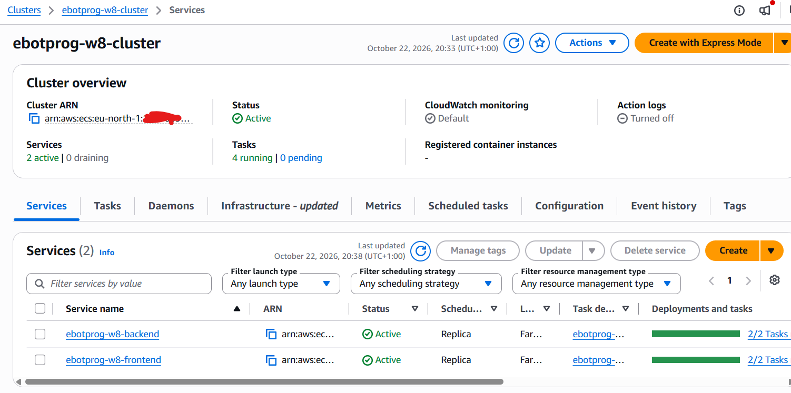

**Backend target group: 2 healthy targets, one in each AZ** (`10.20.10.x` in eu-north-1a, `10.20.11.x` in eu-north-1b). These private IPs belong to the tasks themselves (`awsvpc`). The service registered them; I never added an IP by hand.

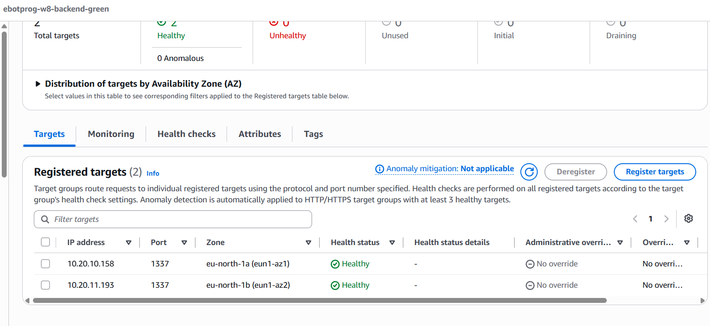

```bash
curl -s "$(terraform output -raw parse_server_url)/health"     # {"status":"ok"}
```

> **Note:** right after `apply`, the frontend loaded but its data calls failed. The `:latest` frontend image had been built in Week 7 with `NEXT_PUBLIC_PARSE_SERVER_URL=http://localhost:1338/parse` baked into the browser JavaScript. That was expected, and the first pipeline run (§12) rebuilt it with the ALB URL.

---

## 9. Self-healing with zero downtime

A loop hit the backend health endpoint through the ALB every second, while a second terminal stopped one backend task:

```bash
URL=$(terraform output -raw parse_server_url)
while true; do echo "$(date +%T) $(curl -s -o /dev/null -w '%{http_code}' $URL/health)"; sleep 1; done
```
```bash
TASK=$(aws ecs list-tasks --region eu-north-1 --cluster ebotprog-w8-cluster \
  --service-name ebotprog-w8-backend --query 'taskArns[0]' --output text)
aws ecs stop-task --region eu-north-1 --cluster ebotprog-w8-cluster --task "$TASK" --reason "self-healing test"
```

**The loop never broke.** The remaining task in the other AZ carried all the traffic:

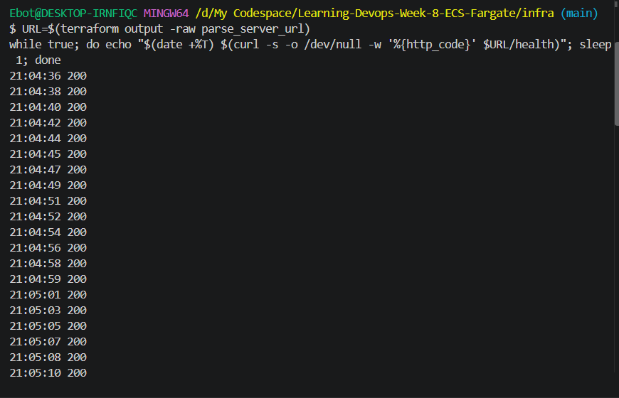

**The service noticed and replaced it.** Events show the old target being deregistered and drained, a new task started, the new target registered, and a steady state reached, all within a minute:

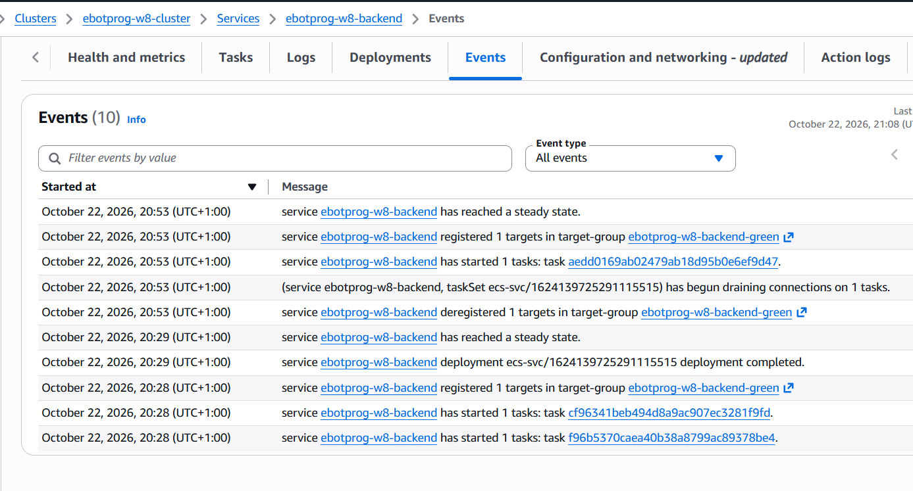

**The replacement** (`10.20.11.221`) in the target group, still `Initial` while it passes its health checks next to the surviving healthy task:

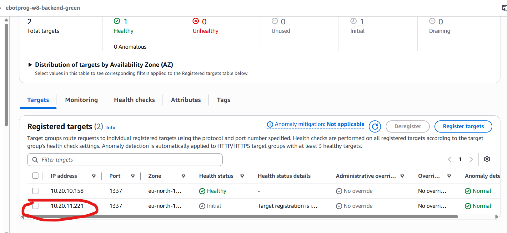

Compare with Step 1, where the site was down until the new task booted and the address changed. That's problems **#1 and #2** solved.

---

## 10. Locking MongoDB Atlas to the NAT IP

All tasks, in both AZs, reach the internet through **one NAT Gateway with one Elastic IP**. That makes a tight database allow-list possible, which wasn't possible in Step 1 where every task had a random public IP.

```bash
terraform output -raw nat_public_ip      # 13.62.215.57
```

In Atlas → Network Access I added `13.62.215.57/32`, waited for **Active**, deleted `0.0.0.0/0`, and confirmed `/parse/health` still returned `ok`.

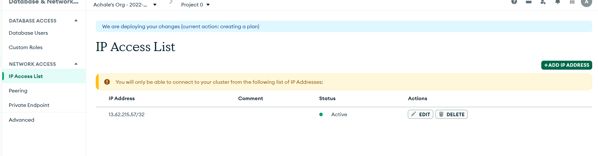

> **Issue: `This is neither a valid IP address nor CIDR notation: $(terraform output -raw nat_public_ip)/32`.** I pasted the shell **command** into Atlas. `$( … )` only works in a terminal: run it there and paste the **output**.

---

## 11. Updating the CI/CD pipeline

### 11.1 The workflow (Week 3 app repo → `.github/workflows/deploy.yml`)

| Job | Change | Why |
|---|---|---|
| `lint-test` | None | |
| `build-and-push` | Added `build-args` to the frontend build | `NEXT_PUBLIC_*` values are compiled into the browser bundle at **build** time, so the image must know the ALB's Parse URL |
| `deploy` | **Replaced** | SSH + `docker compose` became an ECS service update |
| `notify` | None | Discord message on success/failure |

```yaml
build-args: |
  NEXT_PUBLIC_PARSE_APP_ID=${{ vars.PARSE_APP_ID }}
  NEXT_PUBLIC_PARSE_SERVER_URL=${{ vars.PARSE_SERVER_URL }}
```

The new `deploy` job runs once per service (matrix: `frontend`, `backend`):

```yaml
- name: Download current task definition
  run: |
    aws ecs describe-task-definition --task-definition "${PROJECT}-${{ matrix.service }}" \
      --query taskDefinition > task-definition.json

- name: Render new image into task definition
  id: render
  uses: aws-actions/amazon-ecs-render-task-definition@v1
  with:
    task-definition: task-definition.json
    container-name: ${{ matrix.service }}
    image: ${{ steps.login-ecr.outputs.registry }}/${{ matrix.repo }}:${{ needs.build-and-push.outputs.sha }}

- name: Blue/green deploy (ECS built-in)
  uses: aws-actions/amazon-ecs-deploy-task-definition@v2
  with:
    task-definition: ${{ steps.render.outputs.task-definition }}
    cluster: ${{ env.PROJECT }}-cluster
    service: ${{ env.PROJECT }}-${{ matrix.service }}
    wait-for-service-stability: true
    wait-for-minutes: 20
```

Updating a service whose strategy is `BLUE_GREEN` *is* a blue/green deployment. The pipeline doesn't need to know about colours.

**Removed:** the SSH step, the `SSH_PRIVATE_KEY` secret, the `APP_PUBLIC_IP` variable, and Week 7's "open port 22 to 0.0.0.0/0" workaround. Nothing in AWS accepts SSH anymore.

### 11.2 Pipeline identity: a new OIDC role

The Week 7 role (`week7-github-actions-deploy`) only had ECR push permissions, and its Terraform state lives in the Week 7 repo. Week 8 creates its own role, `ebotprog-w8-github-actions`, in `infra/github-oidc.tf`:

- **Trust:** the same Week 3 app repo, using the same wildcard `sub` pattern as Week 7: `repo:EbotProg@*/Learning-Devops-Week-3-Docker-Deep-Dive@*:*`
- **Permissions:** ECR push (as before) **plus** `ecs:RegisterTaskDefinition` / `DescribeTaskDefinition`, `ecs:UpdateService` / `DescribeServices` on the two services only, and `iam:PassRole` on the execution role (registering a task definition "hands" that role to ECS).

Destroying Week 8 never touches Week 7's role. I also removed the copy of Week 7's `github-actions-role.tf` I had placed in the Week 8 folder. Loaded together with `github-oidc.tf`, it would have duplicated the provider and data blocks and tried to recreate an existing role.

### 11.3 GitHub repository variables (Week 3 app repo)

| Name | Value | Action |
|---|---|---|
| `AWS_ROLE_ARN` | `terraform output -raw github_actions_role_arn` | Changed to the Week 8 role |
| `PARSE_APP_ID` | `myAppId` | Added (must match `parse_app_id` in Terraform, which the backend checks) |
| `PARSE_SERVER_URL` | `terraform output -raw parse_server_url` | Added |
| `DISCORD_WEBHOOK_URL` (secret) | unchanged | Kept |
| `APP_PUBLIC_IP`, `SSH_PRIVATE_KEY` | | Deleted |

> **Why `PARSE_APP_ID` appears twice** (GitHub *and* `terraform.tfvars`): GitHub uses it at **build** time (baked into the browser bundle); Terraform uses it at **run** time (the backend's `APP_ID`). Neither tool can read the other's settings, and the browser's ID must match the backend's.

> **Issue: `AWS_ROLE_ARN` held the text `terraform output -raw github_actions_role_arn`.** Same mistake as the Atlas entry: GitHub stores exactly what you type. Fixed by pasting the ARN the command prints.

> **Issue: `Could not assume role with OIDC: Not authorized to perform sts:AssumeRoleWithWebIdentity`.** The trust policy didn't match the repo's token. `terraform.tfvars` still had the example placeholders `github_owner_id = "<owner-id>"` / `github_repo_id = "<repo-id>"`, so the trusted `sub` was literally `repo:EbotProg@<owner-id>/…`. Comparing it with Week 7's working role (`aws iam get-role … --query Role.AssumeRolePolicyDocument`) showed Week 7 used wildcards (`EbotProg@*/…@*`). Fixed by setting both IDs to `"*"`, running `terraform apply` (only the trust policy changed) and re-running the jobs.

### 11.4 Pushing through submodules

To give the pipeline something visible to deploy, I changed the home page text in the frontend submodule.

> **Issue: `fatal: You are not currently on a branch` when pushing the submodule.** The parent repo pins each submodule to a **commit**, not a branch, so inside a submodule you're on a detached HEAD. Fixed with `git push origin HEAD:crud-multistage-final`. The push output (`fbe348c..eb4b54b`) confirmed the submodule was already on the tip of `crud-multistage-final`, not `main`. I then checked out the branch to leave detached HEAD, recorded `branch = crud-multistage-final` for both submodules in `.gitmodules`, and committed the new submodule pointer in the parent.
> **Order matters:** push the **submodule first**, then the parent. Otherwise the pipeline's `checkout` with `submodules: true` can't find the pinned commit.

---

## 12. First blue/green deployment through the pipeline

Pushing to `master` in the Week 3 app repo ran the full pipeline: lint (both apps), build and push, deploy (frontend and backend in parallel), notify.

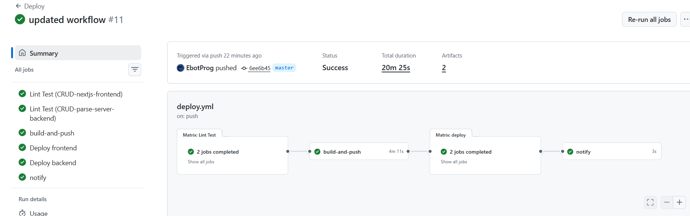

Total time was **20m 25s**. `build-and-push` took 4m 11s, and most of the rest is each deploy job deliberately waiting through scale-up, traffic shift and the **5-minute bake time** before reporting success.

**The deployment timeline in ECS** (frontend → Deployments tab): green tasks scaled up (2 started), production traffic shifted, a 5-minute bake time while blue stayed alive, blue terminated, complete in 7m 5s.

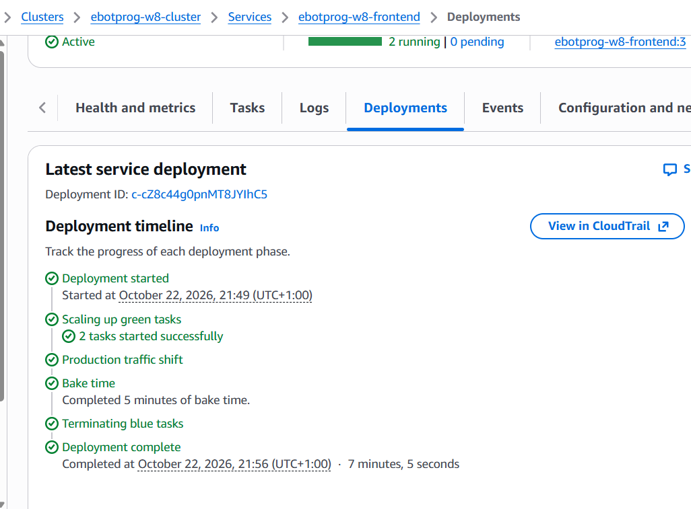

**Where the traffic goes:** the `:80` listener has the weighted rule (`/*` → `frontend-blue` and `frontend-green`) plus the default 404 fallback. At capture time the weights were **blue 100% / green 0%**. Every deployment flips them, which is the whole traffic switch.

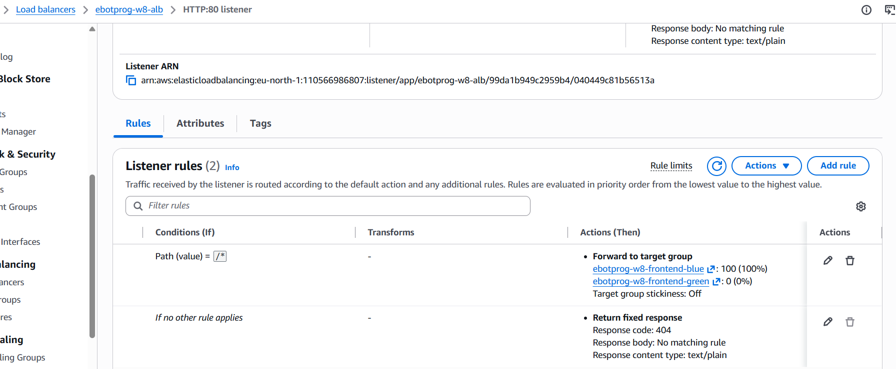

**Target groups after the first pipeline deployment:** production had moved to **green** (2 healthy targets in 2 AZs), and blue was empty because its tasks were terminated after the bake time.

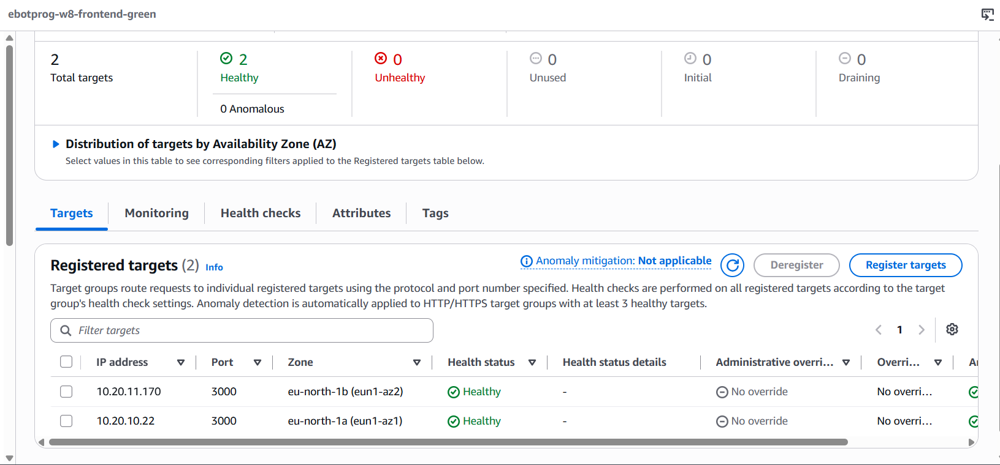

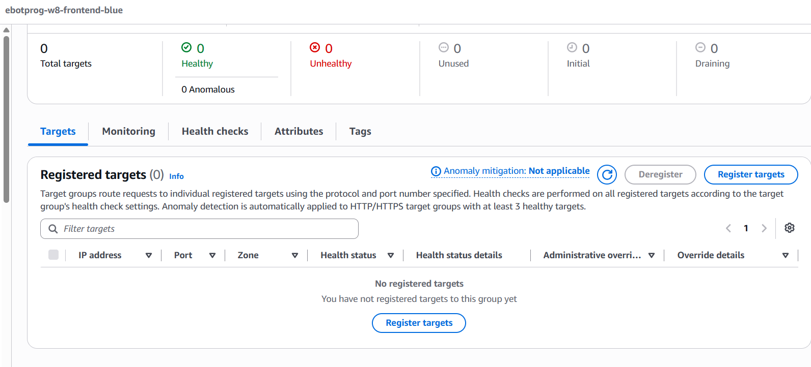

**The app, served through the ALB with the rebuilt frontend:**

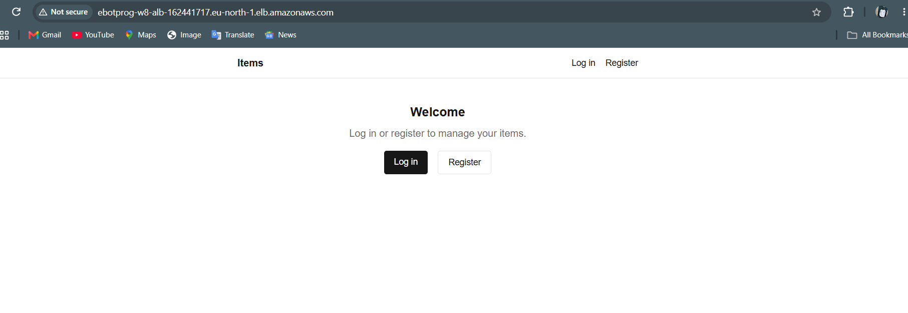

**Discord notification from the `notify` job:**

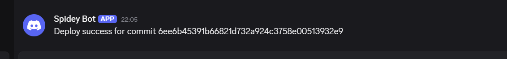

> **Note:** the colours alternate. The next deployment goes green → blue, and so on. "Blue" just means "whatever is live right now".

---

## 13. Rollback demos

### A. Manual rollback during bake time

I pushed a visible change and, once the deployment reached **bake time** (traffic already on the new version), rolled it back:

```bash
ARN=$(aws ecs list-service-deployments --region eu-north-1 --cluster ebotprog-w8-cluster \
  --service ebotprog-w8-frontend --query 'sort_by(serviceDeployments,&createdAt)[-1].serviceDeploymentArn' --output text)
aws ecs stop-service-deployment --region eu-north-1 --service-deployment-arn "$ARN" --stop-type ROLLBACK
```

The rule weights flipped back in seconds, because the previous version's tasks were never stopped. The pipeline's `Deploy frontend` job then failed with `Deployment … not found after stabilization. The deployment was likely rolled back…`. That's **expected**: the action waited for a deployment I had deliberately rolled back.

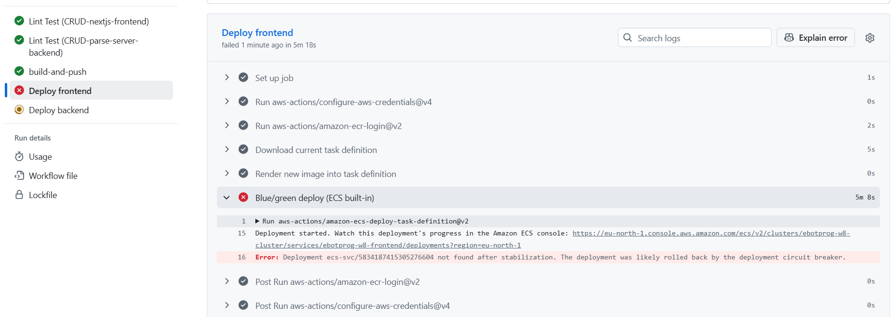

### B. Automatic rollback of a broken release

I registered a revision pointing at an image tag that doesn't exist, then deployed it by hand (no code push):

```bash
cd infra
terraform apply -var 'image_tags={frontend="does-not-exist",backend="latest"}'   # registers a broken revision only
./scripts/deploy.sh frontend                                                    # update-service + watch lifecycle stages
```

Green tasks could not start (`CannotPullContainerError: pull image manifest has been retried 7 time(s)`). The deployment never got past **Scaling up green tasks**, so production traffic never moved, and the circuit breaker rolled it back.

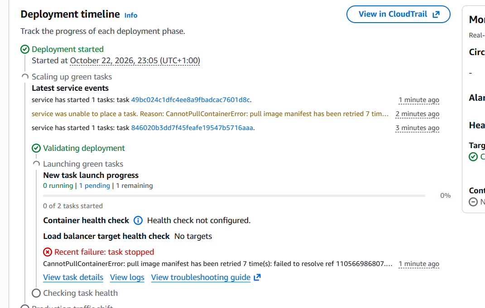

The service then showed **Deployment status: Rollback successful**, still running the last good revision (`ebotprog-w8-frontend:3`). It's visible at the top of the autoscaling screenshot in §14. Afterwards, `terraform apply` (defaults) registered a good revision again.

> **Lesson:** with blue/green, a broken release costs **nothing** for users. Traffic only shifts after green is healthy, and blue stays alive until the bake time ends.

---

## 14. Autoscaling demo

**Policy:** keep average CPU at **60%**, minimum **2**, maximum **4** tasks per service. Scale-out cooldown 60s, scale-in cooldown 300s.

The load test ran from **AWS CloudShell** in eu-north-1, inside AWS, so my own internet speed wasn't the bottleneck:

```bash
sudo dnf install -y httpd-tools
ALB=$(aws elbv2 describe-load-balancers --names ebotprog-w8-alb --query 'LoadBalancers[0].DNSName' --output text)
ab -t 360 -n 10000000 -c 200 http://$ALB/
```

Result: ~**1,594 requests/second**, median **105 ms**, 99% under 367 ms, at 200 concurrent connections.

**CPU and the scale-out alarm:** CPU jumped from ~0% to **~99%** and stayed there for about 6 minutes, far above the 60% threshold (`CPUUtilization > 60 for 3 datapoints within 3 minutes`):

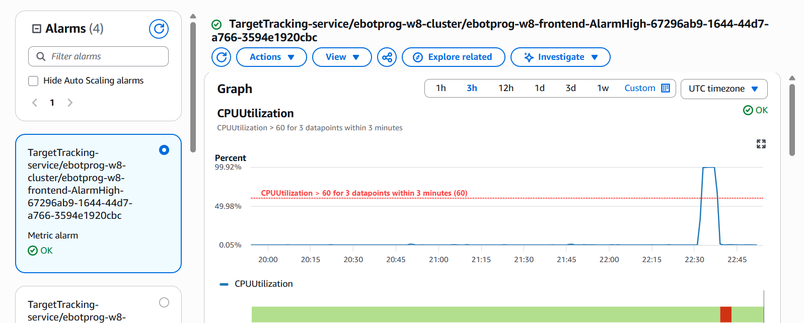

**The scaling action, triggered by the alarm.** The service events show the cause explicitly: *"Successfully set desired count to 4 … monitor alarm … AlarmHigh … in state ALARM triggered policy ebotprog-w8-frontend-cpu"*, followed by 2 new tasks started and registered in the target group:

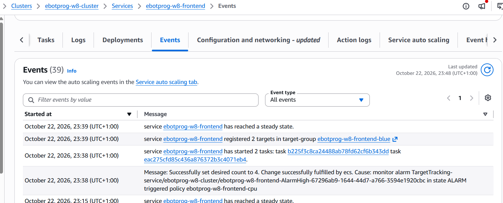

**Result: 4 desired, 4 running** (the policy jumped straight to the maximum because CPU was ~99/60 ≈ 1.65× over target on 2 tasks):

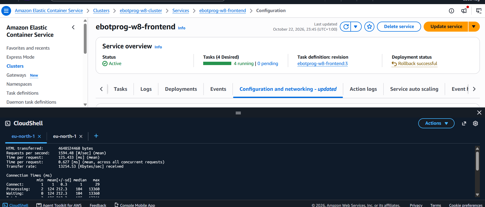

> **Issue: "the tasks didn't increase".** While watching, nothing seemed to happen. CloudWatch showed CPU at ~99% from 22:33 to 22:38 UTC, and `aws application-autoscaling describe-scaling-activities` showed `Successful – Setting desired count to 4` at **22:38:45**, just as the test finished. Target tracking needs **3 consecutive one-minute datapoints** above target plus ~1–2 minutes of metric delay, so it acts in minutes, not seconds. That's by design, so it doesn't react to short spikes.

> **Issue: the `hey` download link returned an S3 XML error page** (`syntax error near unexpected token newline` when executed). I used ApacheBench (`ab`, from `httpd-tools`) instead.

> **Issue: CloudShell `bash: alb_dns_name: No such file or directory`.** `<alb_dns_name>` was a placeholder, and bash read `<` as input redirection. CloudShell has no Terraform state, so I looked the DNS name up with `aws elbv2 describe-load-balancers`. Pasting earlier output including the `~ $` prompts also caused `Is a directory` errors.

> **Tip:** `export AWS_PAGER=""` stops the AWS CLI from opening a pager (`(END)`) on long outputs.

Once the load stopped, the **AlarmLow** alarm (CPU below 54%) drives scale-in back to 2 tasks after the cooldown.

---

## 15. Issues faced (summary)

| # | Issue | Cause | Fix |
|---|---|---|---|
| 1 | `no such host` for STS | Local DNS/connectivity | Restore DNS, verify with `aws sts get-caller-identity` |
| 2 | `logGroupName` regex error | Git Bash path conversion | `MSYS_NO_PATHCONV=1` |
| 3 | No free M0 in Atlas | One free cluster per project | Reused `Cluster0` |
| 4 | Backend crash loop | Placeholder Atlas hostname | Real connection string; read CloudWatch logs |
| 5 | `contains()` on `None` | Untagged ECR images | Query `imageTag=latest` directly |
| 6 | No remote state | Initially omitted | `backend.tf` with key `week8/terraform.tfstate` |
| 7 | `SubscriptionRequiredException` (CodeDeploy) | Free-plan account blocked CodeDeploy | Switched to ECS built-in blue/green, provider 6.4+ |
| 8 | Duplicate role file risk | Copied Week 7 `github-actions-role.tf` | Removed; new role in `github-oidc.tf` |
| 9 | Invalid Atlas entry / wrong `AWS_ROLE_ARN` | Pasted commands instead of their output | Run in terminal, paste output |
| 10 | `Not authorized to perform sts:AssumeRoleWithWebIdentity` | Placeholder owner/repo IDs in trust policy | Wildcards `"*"` like Week 7, re-apply |
| 11 | Detached HEAD in submodule | Submodules pin commits | `git push origin HEAD:crud-multistage-final`, `.gitmodules` branch |
| 12 | Pipeline "failed" after manual rollback | Action waits for a deployment that was rolled back | Expected, documented |
| 13 | `hey` binary was an XML error | Dead download link | ApacheBench |
| 14 | Autoscaling "not happening" | Metric/alarm delay | Waited; verified with scaling activities |

---

## 16. Deliverables checklist

| Deliverable | Status | Evidence |
|---|---|---|
| Infrastructure as code with remote state | ✅ | `infra/`, plan/apply screenshots, S3 key `week8/` |
| ECS on Fargate, 2 services, multi-AZ | ✅ | Cluster 2/2 + 2/2, targets in eu-north-1a and 1b |
| Tasks in private subnets, ALB-only access | ✅ | Private target IPs, SG chaining (`tasks-sg` ← `alb-sg`) |
| Secrets out of the repo and off servers | ✅ | SSM SecureString, injected via execution role |
| Self-healing / high availability | ✅ | Unbroken `200` loop, service events |
| Database locked down | ✅ | Atlas allows only the NAT IP |
| CI/CD to ECS (no SSH) | ✅ | Actions run #11, Discord message |
| Blue/green deployments | ✅ | Deployment timeline, listener rule weights, target groups |
| Manual rollback | ✅ | Rolled back during bake time; pipeline shows it |
| Automatic rollback | ✅ | `CannotPullContainerError` → Rollback successful |
| Autoscaling | ✅ | Alarm graph, scaling event, 4/4 tasks |

---

## 17. Open items and next steps

- **HTTPS + custom domain.** The app is served over plain HTTP on the ALB DNS name. Next: an ACM certificate, a `:443` listener, and the optional `domain_name` (`w8.ebotprog.ink`) in `dns.tf`.
- **Scale-in screenshot.** Scale-out is evidenced. Capture the second scaling activity (`Setting desired count to 2`) to show scale-in as well.
- **Test listener for green.** ECS blue/green supports a test listener rule (e.g. `:8080`) to check green before production traffic shifts. Not used here.
- **Alarm-based rollback.** Rollback currently relies on the circuit breaker (tasks failing to start). Adding CloudWatch alarms (e.g. 5xx rate) to the deployment would also catch releases that *start* but misbehave.
- **Single NAT Gateway.** It's a cost-saving choice. Production would use one NAT per AZ, so losing an AZ can't cut outbound access for the other.
- **`MASTER_KEY_IPS = 0.0.0.0/0,::0`** carried over from Week 3. It should be narrowed.
- **Parse Dashboard** was dropped. It could return as a third ECS service behind its own listener rule.
- **Account plan.** CodeDeploy remains unavailable on this account while it's on the Free plan.

---

## 18. Cleanup

```bash
cd infra
terraform destroy
```

This destroys the NAT Gateway, ALB, ECS services, SSM parameters, roles and networking. Task definition revisions remain as `INACTIVE` (free). The S3 state bucket, the DynamoDB lock table and the Atlas M0 cluster are kept; they cost nothing and are reused by later projects.
